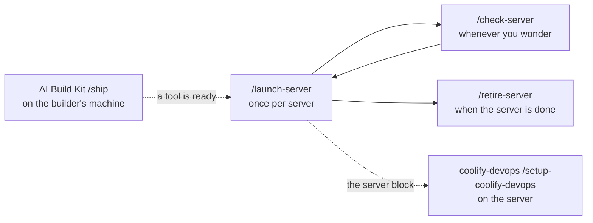

# coolify-launchpad

[](LICENSE)
[](https://github.com/gwpicard/coolify-launchpad/releases/latest)
[](#for-technical-people)

Commands for Claude Code that take a small team from "we have no server" to a
Coolify server on the team's private network, firewalled, with the handover
written down, in one sitting.

You do not need to know Linux, Docker, or cloud firewalls. You do need to decide
who may reach the dashboard, whether anything will face the internet, and to
create one admin account in a browser when asked. It is the middle of a trio:
[AI Build Kit](https://github.com/gwpicard/ai-build-kit) builds and checks a tool
on the builder's machine; coolify-launchpad makes the server exist; and
[coolify-devops](https://github.com/KasperHonore/coolify-devops) runs on that
server and takes the tool to an address. [docs/positioning.md](docs/positioning.md)
tells the whole story.

## At a glance

| | |
|---|---|
| What it is | Commands you type into Claude Code on your own computer, and a Pulumi program behind them. |
| Who it is for | Someone who will own a team's server and has never set one up. |
| Works with | [Hetzner Cloud](https://www.hetzner.com/cloud), [Tailscale](https://tailscale.com), and [Coolify](https://coolify.io) 4.x. Claude Code in this version. |
| You need | Claude Code, Node 20 or newer, the Pulumi CLI, a Hetzner Cloud account with a read and write API token, and a Tailscale tailnet with MagicDNS and HTTPS enabled, with this computer on it. |
| Install | Clone this repository. That is the whole install in this version. |
| Then type | `/launch-server` |
| How long a launch takes | One interview of six questions, then about fifteen minutes while the server builds, with one browser step in the middle. |
| Where it runs | On your own computer, in the cloned folder. The server it makes is on Hetzner. |
| Status | Pre-release. Not yet run against a real server. |
| Licence | MIT |
| Cost | Free. You pay for the server and the coding agent subscription. |

## Install

One route in this version: clone the repository and work inside it.

```bash
git clone https://github.com/gwpicard/coolify-launchpad
cd coolify-launchpad
npm install
cp .env.example .env.<name>
chmod 600 .env.<name>
```

Fill in `.env.<name>`. It holds three values: your Hetzner API token, a
passphrase Pulumi uses to encrypt its own state, and a Tailscale auth key. The
file is ignored by Git. The launch checks that each value is set and that only
you can read the file, hands the values to Pulumi, and never prints them. Pulumi
keeps its state in `.pulumi/` in this folder; the launch points it there itself,
so there is no separate login step.

Start Claude Code in that folder and type `/launch-server`. The agent asks six
questions one at a time, checks what it needs before spending any money, builds
the server, waits while you create the admin account in your browser, closes the
firewall, and prints a server block you carry to the server.

The cloned folder is also where the records live, so keep it. Do not install the
skills on their own: without the program beside them they cannot do anything.

## What this is

Coolify installs with one command, and its own documentation tells you which
ports to open. What it does not give a first-time owner is the order that keeps
the server safe while it is being made: the firewall before the install, the
admin account before anything is reachable from the internet, SSH only over the
private network, and a record of what was decided.

The launchpad carries that order. It rents the server, joins it to your tailnet,
installs Coolify, waits for you to claim the admin account over the tailnet, and
only then opens the ports the lane you chose needs. It stops where
coolify-devops's own setup command starts, and hands over in writing.

## Commands

Command names say when to use them.

| When | Type | What it does |
|---|---|---|
| I need a server | `/launch-server` | Interview, preflight, build, the browser step, the firewall, the server block. |
| Is the server still right? | `/check-server` | Ports, tailnet, Coolify, the env file, the tooling. Read-only. |
| I am done with this server | `/retire-server` | Destroys the server and everything on it, after you type its name. |

There is no fourth command. Changing a running server is coolify-devops's job.

## How a launch flows



You run `/launch-server` once per server. It ends with a server block, a short
piece of plain text. You carry that block to a session on the server, where
coolify-devops's setup command reads it as answers instead of asking you.

Every boundary is crossed by a person. The launchpad never calls the server's
session, and coolify-devops never calls back. That is on purpose, and
[docs/positioning.md](docs/positioning.md) explains why.

## Examples

A first server. You type `/launch-server`. The agent asks for a name, where the
server should run, whether anything will face the internet, and who may reach
the dashboard. It checks your tokens are present, your tailnet is ready, and
Pulumi is installed. Then it builds. About ten minutes in, it asks you to open
an address in your browser and create the admin account. When you have, it
closes the firewall and prints the server block.

A worry. You type `/check-server` a month later. The agent probes the public
ports, reads the tailnet state, confirms Coolify answers over the tailnet, and
prints one table with anything broken at the top.

The end. You type `/retire-server`. The agent tells you what will be destroyed,
waits for you to type the server's name, and takes it down. It then tells you
the one step it cannot do, removing the machine from your Tailscale console.

## Configuration

| What you can change | Where |
|---|---|
| Server size, location, lane, dashboard exposure | `servers/<name>.yaml`, written by the interview. |
| Keys and tokens | `.env.<name>`, ignored by Git. Read for presence only. |
| What the server block says | Nothing. It reports what was built. |

Treat the `skills/` folder as a managed package. Update it with `git pull`
rather than by editing it.

## The records

Three files per server hold its memory, all inside the cloned folder.
`servers/<name>.yaml` is what you asked for. `servers/<name>.block.txt` is the
server block, what was actually built and what is still yours to do.
`.env.<name>` is the secrets, ignored by Git. Pulumi's own state sits in
`.pulumi/`, also ignored.

## Which lane will it be on?

The launchpad asks two questions that decide the firewall.

| Question | Answer | What opens |
|---|---|---|
| Will anything face the internet? | No (default) | Nothing for it. |
| | Yes, with a domain | Ports 80 and 443. |
| Who may reach the Coolify dashboard? | Only the team, over the tailnet | Nothing. Releases are manual redeploys. |
| | The team, plus GitHub (default) | Port 8000 to GitHub's webhook ranges only, so a push deploys. |
| | Anyone on the internet | Port 8000 to everyone. 2FA is mandatory. |

The default pair, no public apps and GitHub allowed, is what AI Build Kit's
`/ship` relies on for its preview address and push-to-deploy. Port 22 is never
open: SSH goes over the tailnet. [docs/server-model.md](docs/server-model.md)
carries the full table.

## What the kit does to reduce risk

Nothing is reachable from the internet until you have claimed the server. The
firewall goes on before Coolify installs, the admin account is created over the
tailnet, and only then do the lane's ports open. Whoever reaches Coolify's first
page owns the server, so that page is never on the internet.

Secrets are checked for presence and never read. The three values in
`.env.<name>` are never printed, and the Hetzner token never leaves your
computer for the server. The server gets a placeholder for its own token, which
you fill in there.

Every claim in the server block is something the agent checked, or is marked as
your word. The probe of the public ports runs and is compared to the expected
table; a mismatch stops the launch. Two-factor authentication is something you
confirm, and the block says so.

## How it compares

| | Where it runs | What you type | What you get |
|---|---|---|---|
| Hetzner console by hand | your browser | clicks, then commands over SSH | A server. Coolify's docs list the ports to open, and the order that keeps it safe is yours to know. |
| AI Build Kit | the project repo | `/ship` | Decides when a tool is ready to rely on. Does not host it. |
| coolify-launchpad | your computer | `/launch-server` | A Coolify server on your tailnet, firewalled to the lane you chose, with the handover written down. Does not host anything on it. |
| coolify-devops | the server | `/host`, `/change-service`, `/health`, `/grant-access` | The hosting discipline, with the deployment repo as the record. |

## FAQ

**Do I need to know how to run a server?**
No. The three commands are the whole interface. You do have to decide who may
reach the dashboard and whether anything faces the internet, and create one
admin account in a browser.

**Do I have to use AI Build Kit or coolify-devops?**
No. The server block is plain text anyone can read, and the server it
describes is an ordinary Coolify server. The firewall rules and the env file are
shaped for coolify-devops, so that is where they fit without extra work.

**Why is nothing open to the internet at first?**
Because whoever reaches Coolify's registration page first owns the server. The
launchpad keeps that page on the tailnet only until you have created the admin
account, then opens what your lane needs.

**What if the launch fails halfway?**
The agent prints what it reached and what stopped it. Run the launch again with
`--resume` to continue from the server that exists, or `/retire-server` to take
it down and start over. Nothing already written on the server is overwritten by
a resume.

**Does anything leave my computer?**
Calls to Hetzner's API, and the Tailscale auth key, which travels to the new
server inside Hetzner's user-data so the server can join your tailnet. In
`github` mode the launch also reads GitHub's public list of webhook ranges,
which needs no token. The rest is your own traffic to your own server: SSH, the
port probe and one request to Coolify over the tailnet. The server block is
written to a local file.

**Which coding agents does this work with?**
Claude Code in this version. The commands are Agent Skills, so other agents are
possible later.

**What does it cost?**
The kit is free. A server on Hetzner is a few euros a month, and the exact
price for the default size is confirmed at the first real run. Tailscale is free
for small teams. You pay for the coding agent subscription.

**Can I use a server I already have?**
Not in this version. The launchpad creates a Hetzner server; installing onto an
existing machine is a possible later addition.

**Is this right for my server?**
It is strongest for one server, owned by one small team, hosting the team's own
tools, mostly on the private network. It assumes Hetzner, Tailscale, and Coolify
4.x, and it hands over to coolify-devops.

## What it does not promise

The kit is free software, provided as is, under the [MIT licence](LICENSE).
There is no warranty, and the licence's own terms are the ones that apply.

This version has not been run against a real server. Several facts in the
design are marked to be confirmed at the first rehearsal, and the rehearsal
record will say which held.

The commands verify what they can reach from your computer and from the server.
A matched port probe means the ports you can see answered as expected, which is
a smaller claim than the server being secure. Two-factor authentication is your
word, not a check.

You own the exposure decisions. The kit recommends the private lane and asks
every time; it does not decide for you whether a dashboard belongs on the
internet, and it does not carry the consequences when it does.

It is not a substitute for a professional operator, and it is not security
advice.

## Contributing

Problems and suggestions belong in the
[public issue tracker](https://github.com/gwpicard/coolify-launchpad/issues).
Read [CONTRIBUTING.md](CONTRIBUTING.md) before opening one. Anything security
related is covered in [SECURITY.md](SECURITY.md).

## For technical people

The repository is an Agent Skills source and an operator's working folder at the
same time. `skills/` holds the three commands in the Agent Skills format;
`.claude/commands/` holds the adapters generated from them, which is why cloning
is installing for Claude Code. `program/` is a Pulumi program with cloud-init
snippets, `lib/` is the TypeScript the skills drive, and `scripts/` is the
dispatcher. A skill never runs `pulumi` itself. It runs `npm run launch` and
reads structured progress events.

Pulumi uses its local backend, encrypted with the passphrase in `.env.<name>`.
State lives in `.pulumi/` inside the clone and is ignored by Git. The Hetzner
firewall resource ignores changes to its rules after creation, so the launch can
replace them once the admin account exists, and coolify-devops can own them
afterwards.

The other install routes, the shared skills installer and the Claude Code
plugin, are planned for a later version once a skill can fetch the program for
itself.

`npm run check` runs the type check, the unit tests, the prose rule guards, the
Agent Skills reference validator over each skill, and the adapter drift check.
`AGENTS.md` is the contributor guide, for agents and people alike.
`docs/maintaining.md` holds the writing rules and the release steps, and
`tests/rehearsal.md` holds the record of real runs.
