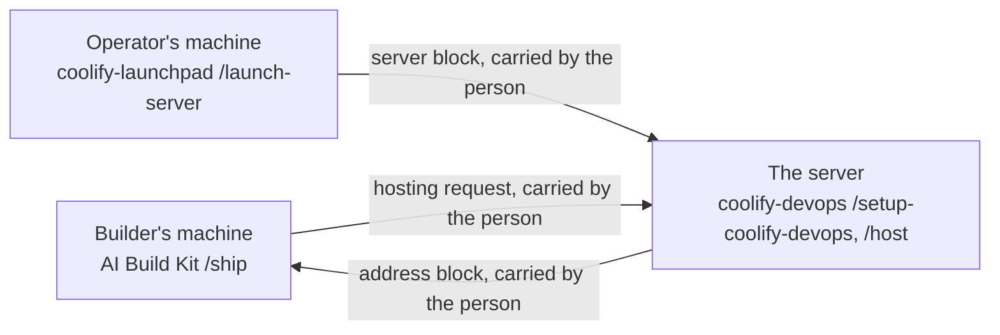

# Where coolify-launchpad sits

This document owns the story of how three kits fit together. Everything else in this repository links here rather than retelling it.

## The chain

A tool built by a small team passes through four steps on three machines.

1. [AI Build Kit](https://github.com/gwpicard/ai-build-kit) `/ship`, on the builder's machine. It decides the tool is ready to rely on, and prints a hosting request.
2. coolify-launchpad, on the operator's machine. It makes a server exist: rented, on the tailnet, behind a firewall, running Coolify. It prints a server block.
3. [coolify-devops](https://github.com/KasperHonore/coolify-devops) `/setup-coolify-devops`, on the server. It locks the server down, deploys the tailnet plumbing, and passes a canary.
4. coolify-devops `/host`, on the server. It takes the tool to an address and prints an address block.



Nothing on this picture is a network call between kits. Every arrow is a person copying a block of text from one session and pasting it into another.

## Who decides what

coolify-devops states the split between the first and last kit in one sentence: "`/ship` decides whether and what goes live; `/host` decides where and how it runs; the address is the only thing that crosses."

The launchpad adds one clause. It decides that a server exists and how it is reached. It never decides what runs on it. Once the server block is handed over, the launchpad has no further part in the life of that server, apart from checking it or retiring it when asked.

Three things cross the boundaries. The hosting request goes from the builder to the server, the server block goes from the operator to the server, and the address block comes back from the server to the builder. Each is a fenced block of plain text with no secret in it.

## Two safety properties

Both existing kits are built around the same two rules, and this one keeps them.

A human stands between "ready" and "live". The builder's `/ship` and the server's `/host` are two sessions on two machines by design. The launchpad sits on a third machine and keeps the same distance: it does not call the Coolify API, does not read the builder's repo, and does not run anything on the server after the hand-over except the checks the person asks for.

No kit writes into another kit's repo. coolify-devops never edits a product repo. AI Build Kit never writes onto a server. The launchpad never writes into a deployment repo: it leaves `/root` free of `AGENTS.md`, `CLAUDE.md`, `instance.yaml`, `docs/` and `stacks/`, because coolify-devops's scaffolder refuses to run when any of them is present. The person is the transport both ways.

## Against AI Build Kit's rule

AI Build Kit says it "holds nothing that needs a service somebody else runs": no hosted scanning, no monitoring, nothing a person has to watch and pay for. Where a project needs such a service, its fit check names it as outside help.

The launchpad is on the other side of that line, on purpose. It creates exactly such a service, once, and then hands it over. The person owns the Hetzner account and pays the bill. coolify-devops operates the server from then on. The launchpad's own record of the server is one file in the operator's folder and one Pulumi stack, and `/retire-server` removes both along with the server itself.

## The boundary rule

coolify-devops's `/setup-coolify-devops` lists five preconditions that are "outside any repo's reach" and hands each to the human as a prepared step. The launchpad stops exactly there. It satisfies some of them and hands the rest over, and it never does the work that comes after: no registrar, no canary, no projects, no hosting.

What the launchpad satisfies:

- The server exists, runs Coolify, is on the tailnet, and sits behind the cloud firewall that matches the lane answers. Coolify's admin account exists, created by the person over the tailnet before anything opened to the internet.
- The MCP env file exists at `/root/.config/coolify-devops.env`, mode 600, sourced from `.bashrc`, with the URL half filled in. The token line is left for the person.
- Tailscale is on the host, signed in with SSH on, tagged `tag:server`, with key expiry disabled. The tailnet policy holds the tag owner and the SSH grant that lets the operator's group reach root on tagged nodes.

What the launchpad hands over, as unmarked steps with the exact console path or command:

- The Coolify API token, created in the Coolify UI and added to the env file on the server. It never enters a launchpad session.
- The `autoApprovers.services` policy entry and the Tailscale OAuth client for the registrar.
- The DNS token, only when there is a public lane.
- The GitHub App, after coolify-devops has accepted the server.

## The server block

This is the format the launchpad prints and writes to `servers/<name>.block.txt`. `/setup-coolify-devops` asks for each of these in its step 1 interview, so the interview becomes a confirmation.

```
Launched by coolify-launchpad
Coolify:        http://localhost:8000 on the host   (from the tailnet: http://<tailnet-ip>:8000)
Server:         Hetzner <type>, <location>, Ubuntu 24.04, public IP <ip>
Tailnet:        <name>.<tailnet>.ts.net, tag:server, key expiry disabled, Tailscale SSH on and granted to root, proved from the operator's machine
Public lane:    none | <suffix> (80 and 443 open)
Dashboard:      tailnet | github (8000 open to GitHub's hook ranges) | internet (8000 open; 2FA confirmed by you, not verified)
Admin:          created by you over the tailnet; Coolify's registration page closed after it | created by you over the tailnet, confirmed by you, not verified
Firewall:       Hetzner firewall "coolify", 22 closed; probe from the operator's machine matched the expectation table
Env file:       /root/.config/coolify-devops.env, mode 600, sourced by .bashrc; the token line is still to fill | the token line is set
On the box:     Node 22, git, jq, Claude Code, coolify-devops skills in /root | git, jq only
Next:           on the server, run /setup-coolify-devops; its step 1 interview confirms this block, and once the
                token is in the env file, a new session resumes at its step 2
```

The Tailnet line names root rather than a group. The launchpad cannot read the tailnet policy, so it cannot say which group the grant names. What it can say is that root on the node answered Tailscale SSH from this computer with every key method switched off. The Admin line says how the launch knew the account existed: Coolify's `/register` page stopped answering 200, or the person said so with `--admin-created`. When only `127.0.0.1:8000` answers on the box, the Coolify line and the env file both use that address instead of `localhost`.

After the block comes a list headed "Still yours to do". Each item carries the exact console path or command. None is marked done, because the launchpad cannot verify a console step it did not perform. The list follows the answers: the Coolify token until it is set, signing in to Claude Code or installing Node, the tailnet policy entries and OAuth client that `/setup-coolify-devops` hands over as its precondition 3, the DNS token when there is a public lane, and the GitHub App in `github` or `internet` mode. In `github` mode that last item says the registration round trip needs the person's own IP on the 8000 rule for one step, as coolify-devops's `provisioning.md` describes. An optional last item covers a separate Hetzner token for coolify-devops, never the launchpad's own.

The launch writes the block and the list together to `servers/<name>.block.txt`, which Git ignores, and `/check-server` prints that file again after its table.

## When the launch stops

A launch that fails partway prints this instead, and the two commands on its last line are the only two ways forward.

```
Not launched yet, coolify-launchpad
Reached:   <the last step that passed>
Finding:   <one line, quoting the log or probe>
Then:      npm run launch -- --server <name> --resume | /retire-server <name>
```

`--resume` re-runs the second phase only. Every step in that phase can be run again without harm: the env file is never overwritten, the skills install is skipped when it has already happened, and the firewall rules are replaced as a whole.
